  

  <b>Electrical, IT & AI Engineer</b> working where industrial automation meets AI. 
  <i>If it repeats, I automate it.</i>

---

### 🔧 Where I come from
By day I plan control systems for industrial production with Siemens TIA Portal, PLC and HMI.
I know what it takes to keep a real machine running, and I bring that mindset to AI.

### 🤖 What I build
- **AlphaCouncil**: a self-hosted multi-agent system for market research (Python, FastAPI, React, Docker)
- **trust-layer**: anytime-valid statistics (e-processes, e-BH) that check whether a pattern is real before anyone trusts it
- **JobForge**: a personal application assistant that drafts but never sends on its own
- **AI automation for businesses** with n8n, LLM agents and self-hosted infrastructure

### 🧰 Tech
`Python` `FastAPI` `C/C++` `TIA Portal` `PLC/HMI` `Docker` `Traefik` `Linux` `n8n` `LLM agents` `Multi-Agent AI`

### 📫 Open to
Roles and projects in industrial automation, AI automation and Python backend development.

  <a href="https://huggingface.co/AlphaWini">🤗 Hugging Face</a> &nbsp;|&nbsp; 📍 Germany &nbsp;|&nbsp; 🇩🇪 Deutsch, 🇬🇧 English

